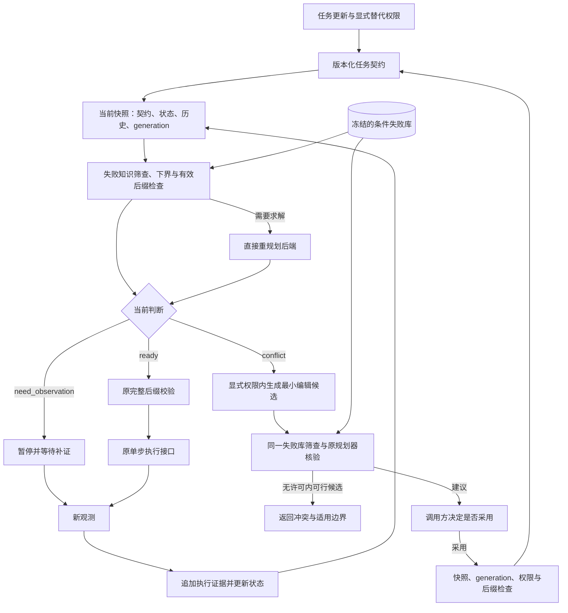

# 第三章与架构型小论文组织稿

建议第三章题目：**执行历史约束下的机器人任务修订与失败知识复用**。

小论文工作题目：**面向持续任务更新的机器人修订监督架构：执行证据保持与失败知识复用**。

核心问题：任务在执行中更新、动作可能无效时，如何保留已发生的证据，在明确的目标替代权限内恢复执行，并避免反复求解已知失败问题。直接重规划保留为后端。当前实验未调用大模型，标题和摘要不把大模型性能作为已验证贡献。

## 1. 中心思想与候选贡献

区分三种内容：**发生过什么**由追加式执行证据表达；**现在要求什么**由带版本与生效锚点的契约表达；**哪些条件组合已核验为失败**由条件失败库表达。任务可以在权限内修订，过去的事件不能被修订成没有发生；失败知识须在适用条件成立时才能复用。

围绕完整机制组织三个候选贡献：

1. **证据保持的任务修订架构。**将历史、当前状态、任务版本和动作许可绑定；区分可执行、模型内冲突、需要补证，避免通过改任务绕过历史争议。
2. **服务于两个决策环节的失败知识复用。**同一冻结条件失败库支持运行时筛查与许可修订候选筛查，不命中时回退完整求解。
3. **修订回接与可审计验证。**建议通过快照、generation、权限和完整后缀校验才可采用；采用不改历史/状态，命令不制造完成证据；以同功能比较、模块消融和独立审计验证整体作用。

这是候选论文贡献的组织方式，不是“文献中没有同构架构”的证明。版本检查属于常规工程机制，不能独立包装成新算法。评价重点是这些接口怎样共同解决持续修订问题，以及整体收益能否复现。

## 2. 已接通的流程

当前调用方采用事先配置的确定策略；图中观测来自有限模型回放，任务为结构化输入。来源阶段提取和认证失败片段后冻结，目标阶段不学习。未来自然语言前端可以提供任务和权限候选，但仍须通过相同检查；这一扩展尚未验证。

## 3. 正文结构

| 章节 | 核心内容 | 已有材料 |
|---|---|---|
| 问题与动机 | 同状态不同历史、动作无效、哪些目标可替代 | 历史语义例子、显式权限 |
| 统一接口 | 快照、历史锚点、任务版本和三种判断 | 原历史契约与 Runtime |
| 失败知识复用 | 适用条件、认证、筛除与完整求解回退 | 冻结片段及部分状态对照 |
| 许可修订 | 成组替换、历史锁定、最小编辑代价 | 原修订搜索与权限核验 |
| 回接执行 | 建议何时过期、采用如何保持证据 | 新协调器、原单步票据、连接测试 |
| 实验与讨论 | 效率、模块作用、接口一致性及边界 | 完整闭环比较与独立审计 |

修订目标表述为：在显式权限允许的契约集合中，寻找在当前快照和 H 内存在 ready 后缀的契约，最小化改写条款数。已发生和有争议的访问锁定，采用不修改状态或事件账本。当前采用枚举与完整规划器验证，不主张新优化求解算法。

## 4. 实验如何支撑贡献

| 问题 | 比较/核查 | 已有结果 | 支持范围 |
|---|---|---|---|
| 共享失败知识是否减少整体费用？ | 四个同功能版本 | 完成均 223/384，轨迹相同；求解 478/410/385/351；时间 4.628/4.018/3.879/3.561 秒 | 本工作负载上的行为保持与费用下降 |
| 采用修订有什么作用？ | 启用/关闭修订 | 223 对 197；配对新增完成 26、减少 0 | 当前合成权限内的模块作用 |
| 回接是否破坏接口要求？ | 正常、过期、伪造/重复、无权限、未知历史、域/上界不一致 | 新增 6 项连接测试，全量 919 项通过 | 指定反例被处理 |
| 完整轨迹是否符合原语义？ | 独立进程用原 API 核查 | 2,233 个快照、188 个修订问题、全部动作目标/转移通过 | 登记有限模型内的一致性 |

数据和严格口径见 [架构闭环报告](/root/autodl-tmp/ch3-planning/docs/architecture_loop_results_20261118.md)。旧静态片段/部分状态实验可以作为机制实验，不能混成新闭环结果。连续序列中的请求并不独立，三次计时不增加独立任务数。

## 5. 已有思想与差异核查方向

下表依据公开论文摘要定位已有思想；它不是对其他架构缺失某机制的全面证明。未提及不能写成不存在，公开成功率也不能跨任务直接比较。

| 相关工作 | 已有思想 | 本文应具体说明什么 |
|---|---|---|
| [SayCan](https://arxiv.org/abs/2204.01691) | 语言模型高层知识与预训练技能价值函数结合，获得环境落地 | 本文的执行历史、任务版本与持续修订接口；模块组合本身不能称首创 |
| [Inner Monologue](https://arxiv.org/abs/2207.05608) | 成功检测、场景描述、人工交互等反馈送回语言规划 | 在反馈之外怎样约束契约、历史与采用；当前未运行该完整系统作对比 |
| [COAST](https://arxiv.org/abs/2405.08572) | 约束任务规划与 stream 运动规划结合 | 不把失败约束视为新思想；比较具体表示和复用途径，不声称本实验胜过 COAST |
| [Automata-based Optimal Planning with Relaxed Specifications](https://arxiv.org/abs/2107.13650) | 许可替换/删除及排序、分组约束下的最小松弛 | 许可内最小修订已有先例；本文候选差异在执行证据和运行时知识服务的连接 |

投稿前对最近似方法全文逐项核查“历史如何保留、知识在哪里用、修订何时生效、怎样接执行”。当前不使用“首次”主张，也不宣称架构新颖性已经最终确认。

## 6. 剩余工作与停止扩展标准

现在可以写第三章与小论文初稿，保持当前问题与架构。新增实验优先提前冻结一份新的任务种子/权限分布，保留四组同功能版本和完整成本口径；现有闭环复用了既有序列，尚不是新的盲测集。

动作层优先复用已有 MuJoCo/MetaWorld 和单物体证据桥，做少量“观测确认—修订—继续执行”案例。三物体可视场景不能替代控制器与可靠事件检测；不要把补验证扩大成新仿真平台工程。自然语言前端若没有实际测试，就只标为扩展接口。

阶段结束标准：问题与架构冻结；同功能主比较、修订消融、独立审计完成；相关工作差异诚实；未覆盖的物理/感知能力按实际范围陈述。本轮已经准备好初稿的主要实证材料，投稿成熟度仍取决于最近似架构差异与目标刊物要求。
