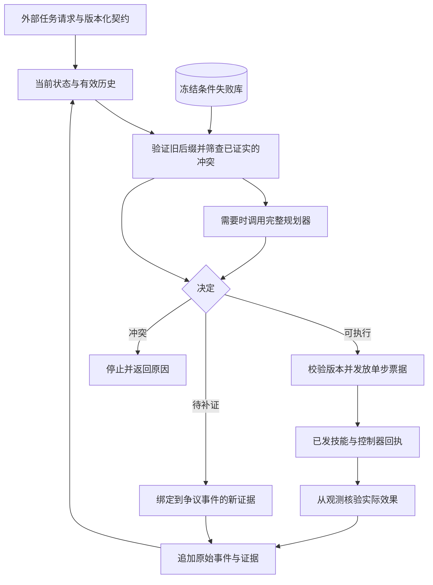

# 第三章创新点定稿与证据核验

建议章名：**面向执行不确定性的历史证据约束任务监督与恢复**。

本轮认定该命题具备作为硕士论文第三章独立方法贡献的证据。研究对象限定为已登记技能和目标、有限动作模型下的执行监督与有界恢复。关键设计是让原任务契约、已记录的动作事件和补充观测各自保留来源，再共同约束同一个执行入口。原目标冻结实验、同等证据下的规划对照，以及历史补证反例，分别验证了恢复效果、计算费用和接口语义。关于多模态大模型端到端优势、真实机器人或 OpenArm 的 ROUTED 比较仍缺直接实验。

## 第三章主张

> 针对动作回执与实际结果不一致、历史证据存在歧义的机器人任务执行，提出一种基于历史证据和任务契约的监督与恢复架构。方法将控制器回执、已记录事件与事后补证纳入分离的接口，为剩余计划提供可执行、待补证及冲突三种判断；新证据使旧执行授权失效，在原任务约束下重新验证后继续。经核验的条件失败知识可在不同请求中复用，从而减少完整求解。

这一贡献依赖三个相互作用的环节：

1. **执行证据决定可以继续什么。**执行回执和观测进入不同接口。原始事件带序号和观测来源；争议事件的补证绑定当前快照与执行代次，保留原记录及新证据。补证或新观测会撤销旧票据，只有重新评估之后才派发下一技能。
2. **原任务继续成立时才恢复。**规划器在当前状态下查验后缀能否兼容所有仍可能的历史解释。保留原目标的恢复用于主实验。显式许可内的目标替代放在独立扩展实验，采用后按修订契约计分。
3. **失败知识在它仍适用时筛查。**适用条件绑定注册模型和动作上界。匹配检查保守地处理已发生或可能已发生的访问，防止把过去可能完成的访问当作必做未来要求来误拒绝。核验后的冲突判断可省完整求解，若无法匹配则回退原规划器。

### 形式化接口与可审查的性质

给定观察支持的当前状态 $s$、契约 $C$、原始事件账本 $L$、事后补证记录 $F$、动作上界 $H$。设 $\mathcal H(L,F)$ 为依照已确认、否定和未知事件形成的可能历史，$\Pi_H(s,C,h)$ 为历史 $h$ 下满足契约的可执行后缀集合。

- 当各历史分支的 $\Pi_H$ 的交集存在元素时可执行，交集中的空后缀表示任务已完成。
- 每个分支都没有后缀时返回模型内冲突。
- 有分支可行但不存在共同后缀时暂停并请求补证；补证允许保留不确定性，系统只在证据支持明确结论时重新判断。

一份已受信的补充观测以确认或否定收缩对应分支。更新只改规划所用的证据解释与观测版本，保留原事件内容、原契约、当前已知状态和事件序号。原状态仍是当前状态，是因为这个接口只处理过去事件的判定；如新观测同时改变当前状态，须经单独的原状态观测接口更新。即使新证据没有改变可用后缀，旧票据仍被撤销。这个性质依赖观察适配器报告正确的证据，当前接口约束绑定、身份及最终性，不独立核验传感器结论，也不支持再次推翻已判定事件。

对失败证书，可把证书核心看成放松后的子问题。只有当核心的约束对每个仍可能的历史分支都是原任务的必要条件，且当前状态和上界落入经核验的拒绝区域时才拒绝。原任务的任何后缀都应当满足该子问题；子问题无解可推出原任务无解。适用域未知、超出上界或不能构成必要条件时，结果回到原规划器判断。

## 新证据及实验口径

**一、固定原目标，128 个 MetaWorld/MuJoCo 回合。**蓝块进绿色区域且空手。采用同一固定低层控制器、仿真 RGB、本体数据和共享动作门控。8 个排布种子、4 种条件、4 组逐个配对。无抬升条件在首次抓取的闭合和抬升阶段把夹爪闭合命令替换为保持张开，模拟受控执行故障；控制器路点回执保持原样。持续缺证据条件还遮蔽相机。用于评分的初段几何快照在监督决策前私下捕获，在决策后解释和计入报告，始终未输入策略；独立终端几何评分在最后执行。

| 方法 | 正常 /8 | 初次未抬升 /8 | 短时失明 /8 | 未抬升且持续失明 /8 | 完成 /32 | 初次错误持物晋升 | 完整求解 |
|---|---:|---:|---:|---:|---:|---:|---:|
| 回执晋升消融 | 8 | 0 | 0 | 0 | 8 | 16 | 32 |
| 观测核验、无重抓恢复 | 8 | 0 | 8 | 0 | 16 | 0 | 32 |
| 同证据直接重规划 | 8 | 8 | 8 | 0 | 24 | 0 | 96 |
| ROUTED | 8 | 8 | 8 | 0 | 24 | 0 | 32 |

两个恢复组的 32 个配对执行比较中，技能、原始观测、低层回执、控制步及终端结果逐一相同。在八个无抬升但可观测的配置里，两组都重抓并完成原目标。持续缺证据的八个配置里，ROUTED 均在两次诊断观测后停止，没有重抓或放置。回执组发出了 24 次缺观察证据的放置请求，其中 16 次对应错误持物晋升，另外 8 次是物体实际持有但观察仍空白。共同物理门控拦截了全部 24 次请求，四组的终端完成误报均为零。求解次数针对每次支持状态更新都重规划的基线；这种短任务中的差距主要来自验证并保留有效后缀，不能外推到只在检测到偏差时求解的实现或物理作业速度。两恢复组各用了 11,382 个在线控制步。

**二、任务契约保留，36 条历史补证闭环。**测试新增顺序、历史访问加未来保护、已生效保护三类约束，分别交换物体角色并检查两种补证结论。36 次在争议时均暂停；收到支持后，18 次正确恢复并完成契约，18 次正确判为冲突。恢复共派发 36 个符号动作。新接口保存原观测、保持历史序号与旧条款的生效锚点，重新评估现有版本。四项新增回归覆盖补证使其可行或不可行、过期和重复证据、旧票据失效。三种同状态同契约反例表明，仅用当前场景无法区分这些结果，任何只读该输入的确定决策器必须在至少一个反例上出错。具有等价历史监控状态的规划器可以作出相同判断。

**三、新固定目标序列，已有失败知识转移。**24 条新三物体连续序列、240 个任务请求，含 72 个带顺序的请求。所有组关闭系统的目标替代，来源库在目标生成前已固定，公共来源缓存与原验证器、原求解器、旧后缀验证及动作下界一致。

| 失败库配置 | 完成 /240 | 全量求解 | 顺序任务求解 | 目标准备加回放中位数 /ms |
|---|---:|---:|---:|---:|
| 空库 | 79 | 191 | 65 | 1346.3 |
| 固定十核心 | 79 | 168 | 58 | 1288.7 |
| 来源部分状态约束 | 79 | 166 | 58 | 1395.2 |
| 完整十八核心 | 79 | 134 | 42 | 1227.4 |

四组共有相同语义轨迹和 524 次动作；每组审计 764 次判断、603 条可执行后缀、524 次动作与观测转移。相对空库减少 29.8% 完整求解，按整条序列重采样，每条平均少 2.375 次，描述性 95% 区间约 [1.79, 3.00]。对来源部分状态约束少 19.3%，每条平均少 1.333 次，区间约 [0.96, 1.71]。结果限于现有来源规则对照，完整部分状态约束可表达同样的精确拒绝区域这一既有结论继续成立。

八轮配对计时中完整库相对空库均更快，相对固定库 5/8、相对来源部分状态约束 7/8。环境为 Linux x86_64、Python 3.10.20、Intel Xeon Platinum 8481C，计时是符号目标阶段墙钟时间。分阶段核算中，既有固定库来源准备中位数 974.8 ms、完整库 1015.2 ms，增量约 40.4 ms。当前负载下相对固定库的配对目标时间差中位数约 53.0 ms，名义摊销点约 0.76 个相同规模的工作负载。两个阶段在不同测量中取得，且相对固定库有反向轮次，因此只作增量成本量级估计。原计时日志中首轮完整库的调用计数 136 含时钟结束后的 2 次独立历史示例查询；原轨迹计数为 134，独立审计保留更正记录，耗时与汇总不变。

**四、许可替代单列。**保留 11 月 17 日的架构结果作扩展实验，比较许可内修订接入效果。在该实验的预设替代权限下，完成按采用后的契约计算，为 223/384 对 197/384。此数字不混入 128 回合原目标恢复或 240 请求固定目标实验。

## 辩证吸收审查与已有工作

审查对成功口径、估计不确定性、来源成本和实际操作桥接的建议成立。它对 OpenArm 进展的描述已经变化：017–019 都通过独立任务成功检查，三轮严格接触规则均未通过。这些回合缺 ROUTED 同条件对照，适合作为回执和独立成功条件需要分开的工程背景。新主实验选择已有 MetaWorld 固定控制器来隔离方法差异。OpenArm 控制移植、五物体以上和复杂感知属于更大应用范围。本轮使用显式补证扩展保留已归档运行时接口；旧三物体适配器仍使用动态绑定，其维护风险与实验正确性的结论分别处理。

| 最近似方向 | 已有方法的实质 | 第三章可主张的范围 |
|---|---|---|
| 执行检查和局部计划修复 | LOGIV 已区分动作完成与后续依赖是否仍成立，检查物理支持，结合任务图修复和剩余计划校验 | 本章聚焦任务更新后如何解释有争议的既往事件，以及补证怎样约束同版本的调度；两者都做执行验证和恢复。实验范围小于 LOGIV。 [LOGIV 全文](https://arxiv.org/html/2610.40016v3#S3.SS3) |
| 三值判断 | LTL/TLTL 运行时验证已有真、假、不确定的定义 | 三分类不是首创。这里的具体语义是已知当前状态下对可能过去历史求共同有界后缀，并用有来源的事后补证重新开闭派发。 [Bauer 等原文](https://christian.schallhart.net/publications/2011--tosem--runtime-verification-for-ltl-and-tltl.pdf) |
| 从失败到约束 | COAST 已在任务与运动规划中按动作、序列或位置加入失败约束 | 将证书作为执行过程中可复用的条件筛查，在保留历史语义的前提下验证主比较；主张其系统作用，不主张发明冲突学习。 [COAST 第 IV 节](https://arxiv.org/html/2405.08572v1#S4) |
| 受偏好的目标修订 | 既有带权编辑系统表达替换、删除及分组限制并求最小松弛 | 许可内修订用于扩展适用范围，其受版本约束的接入值得报告，最小编辑本身不作为核心创新。 [Kamale 等全文](https://arxiv.org/html/2107.13650#S5) |

第三章可以按“问题与形式化 → 证据、契约与派发接口 → 有界恢复及失败知识复用 → 三组主实验 → 许可替代扩展”收口。大模型可以在后续章节提供结构化任务或技能候选，是否提升理解或端到端执行仍以对应模型实验为准。本轮可冻结章内方法主张，写作和答辩报告采用上面的证据范围。

## 可复现材料

- `data/collections/ch3_fixed_goal_physics_20261119_v1/`：协议、128 条轨迹、相机记录、物理评分和汇总。
- `data/collections/ch3_fixed_goal_transfer_20261119_v1/`：24 条新序列、语义轨迹、四组求解日志和八轮计时。
- `data/collections/ch3_innovation_audit_20261119_v1/`：独立仿真轨迹审计、计时调用更正、36 条补证闭环。
- `ch3/revision/evidence_resolution.py`：补证入口。完整项目回归 **923 项通过**。
