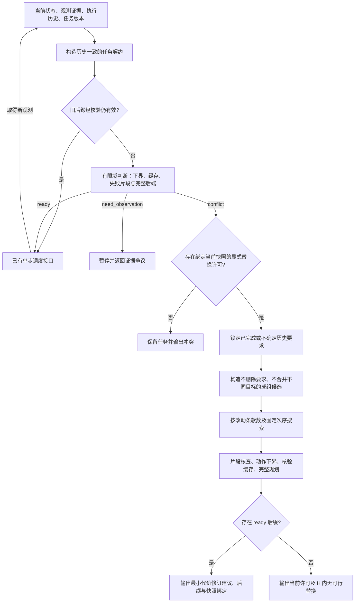

# 第三章方法与实验收束稿

建议章名：**面向执行中任务修订的历史一致性约束与失败知识复用**。

这一轮可以停止增加机制，进入章节整理。当前方法与实验骨架已经完整；这不等于独立小论文算法新颖性已确认，也不等于真实机器人端到端实验已经完成。章节主张应以现有证据为界。

**核心问题。**当任务、状态与执行进展发生变化时，怎样保留仍然生效的要求与已发生的历史，并利用经过核验的失败知识，降低寻找可执行后缀或许可内任务修订的计算代价？直接重规划保留为后端。

**本次确定采用的实现。**任务契约与不可改写的证据账本；绑定有限模型、状态条件及 H 的失败片段；下界与核验后的来源 ready 缓存；许可约束下的成组目标替换；逐候选匹配失败片段并用原完整规划器兜底。目标阶段不学习、不扩缓存，修订只输出建议。舍弃在线缩核和组选项编译作为主方法，因为已有消融显示其成本不划算。

**主要流程图。**上半部是已有监督/规划链路；冲突后的修订部分是本轮离线验证模块，目前没有自动连接到现场执行器。图中的单步调度沿用已有接口，不表示本轮进行了物理实验。

原后端保留 need_observation 语义；本轮主实验未评估感知问询或自动补证性能。修订建议也不会自动回到调度分支，需要任务层选择并采用新的契约版本。

**3.1 问题定义。**定义物体/区域的注册模型、当前状态 s、带 confirmed/unknown/refuted 的历史 h、带版本与 since 的契约 C、动作上界 H，以及外部给定的修订许可 P。区分 ready、conflict、need_observation；conflict 和“无许可替换”均相对当前模型、H 与候选集合。原任务可行性判断和允许改任务后的可行性判断是不同问题，分别报告。

**3.2 历史一致性。**证据账本不记录预测或命令回执为已完成事件；保留要求的 since 不动；真正变更的要求从当前 cursor 生效；旧版本响应不得作用于新快照。历史保护是框架的正确性机制，不把补丁格式、时间戳或普通写集合保护当作首创。

**3.3 失败知识的提取与适用条件。**从有限规划失败中取得包含最小任务核心，变量化并在注册绑定与合法状态上认证。记忆条目必须包含模型、H 与状态适用条件；不能将“一次失败”泛化成无条件禁令。任务阶段共享同一核验机制，不宣称发现了未知物理因果规律。完整部分状态 nogood 与拒绝掩码的覆盖等价应主动说明。

**3.4 许可保持的最小可执行修订。**本章主实验采用每个物体的两个同类暂存位成组互换。外部配置明确给出许可，不从失败猜测等价关系。成组双射保持该物体原来目标的相同/不同关系，条款和物体均不删除；相关已完成/不确定 visit 锁定物体。按改变条款数最少求解，相同代价用固定顺序。只在原完整规划器给出所有允许历史共用的 ready 后缀时，输出可执行建议；源缓存也必须核验后缀。最优性是对这组有限允许替换的保证，不是对任意语言改写的保证。

可用的小例子：黄物体位于 green 且禁止移动黄物体，蓝物体要求到 green。若配置明确允许蓝物体使用 green 或 return，则可建议将蓝的相关目标成组映射到 return，并提供后缀；保护黄物体和所有其他要求仍保留。若没有这份许可，就返回冲突。这个例子已在单元测试验证，未冒充 619 个主实验中的新增样本。

**3.5 实验结构。**围绕五个问题组织结果，不继续新增平台或训练任务：

| 实验问题 | 当前证据 | 论文允许的结论 |
|---|---|---|
| 历史约束是否被保留 | 生效时间、不可逆违约、未知事件、过期绑定等回归 | 框架保持注册语义，不证明独家表示优势 |
| 学到的片段比旧知识有何增量 | 旧十核心与同源十八核心比较 | 可减少有限域下完整求解 |
| 一般部分状态学习能否解释收益 | 来源部分 nogood、完整包络逐表等价 | 完整 nogood 可复现覆盖，不声称独特表达能力 |
| 允许改任务时能否给最优可执行建议 | 删除修订先导与成组替换主实验分别审计 | 保证各自许可集合内的最优性，不混算原任务成功率 |
| 成本和复杂度是否划算 | 全准备费用、共同缓存、在线缩核/选项编译负结果 | 使用简单逐候选版本，只主张已有库后的查询收益 |

替换主实验全部包含 187 次连续回放失败和 432 次静态失败。各组得到同样的 30 / 84 项许可内建议；完整求解从标准搜索的 170 / 659 次降为 87 / 185 次，总费用中位数从 1.931 / 3.402 秒降为 1.301 / 1.398 秒。相对旧十核心，新增来源片段再少求解 36 / 127 次。所有条款保留，原候选空间内最优性经独立原 API 和完整规划器核查。全套测试 913 项通过。

主表须保留来源部分状态对照的 109 / 227 次求解，以及“完整包络同覆盖”的结论。不能只展示无记忆枚举组，也不能将片段总命中数当作净避免求解数。来源学习/建库未计入本轮查询费用，任务集也是既有输入的受控变体，需在实验设置中写清楚。

删除修订的 186 / 420 项建议与成组替换的 30 / 84 项建议属于不同许可集合，不能比较成任务成功率高低；删除组还放弃了部分要求。成组替换无法处理的 505 次失败必须保留，不继续放宽许可制造高修复率。

**可直接采用的贡献表述草案。**

> 构建面向执行中任务修订的历史一致性监督与失败知识复用框架，将经有限模型核验的失败片段用于后续可行性判断及许可约束下的任务修订。框架保留执行证据和未修改要求的生效范围，在明确给定的目标替换许可内生成最小改动的可执行建议，并以完整规划器作为后端。有限符号模型实验表明，在保持修订结果和历史约束一致的前提下，已有失败知识能够减少完整求解及查询阶段费用。

这是方法构建与受控实验贡献的措辞，不是已确认的小论文新型算法首创声明。章节中对现有方法的实质区别必须依据本轮已有强对照，不能使用“首个失败转约束”“首个跨任务迁移”“优于所有重规划”“首次保持用户意图”等表述。

**3.6 适用范围与讨论。**模型已知、注册物体有限、动作数有界，证书与模型和 H 绑定。暂存位等价由配置给定，跨物体实体关系不自动推断；没有从自然语言、视觉或未知物理失败中学习等价关系。实验为符号回放与任务变体，没有新的现场动作。自然语言前端可作为输入接口叙述，不能据这些结果主张大模型理解、开放世界泛化或真实机器人成功率提升。

**与已有文献的关系。**[Automata-based Optimal Planning with Relaxed Specifications](https://arxiv.org/abs/2107.13650)已有许可替换、删除、分组与最小松弛，[最小规约修订](https://arxiv.org/abs/1404.2289)也已有相邻问题。已有 nogood 等价结果进一步限制了当前理论新颖性。现阶段不把本章等同于已完成独立小论文创新；若后续以小论文投稿，需单独审查问题或计算机制的实质增量，不能用本轮速度数字代替新颖性判断。

**收束记录。**本轮停止扩展方法与计时任务，不要求靠训练生成模型、换机器人平台或增大任务规模来维持亮点。已有材料可以进入第三章初稿整理；真实平台实验及独立投稿新颖性仍各有边界，没有在此冒充完成。

详细结果：[成组替换实验报告](/root/autodl-tmp/ch3-planning/docs/fragment_purpose_repair_results_20261117.md)、[上轮修订先导](/root/autodl-tmp/ch3-planning/docs/fragment_repair_results_20261117.md)、[已有方法实质区别核对](/root/autodl-tmp/ch3-planning/docs/fragment_novelty_assessment_20261117.md)。
