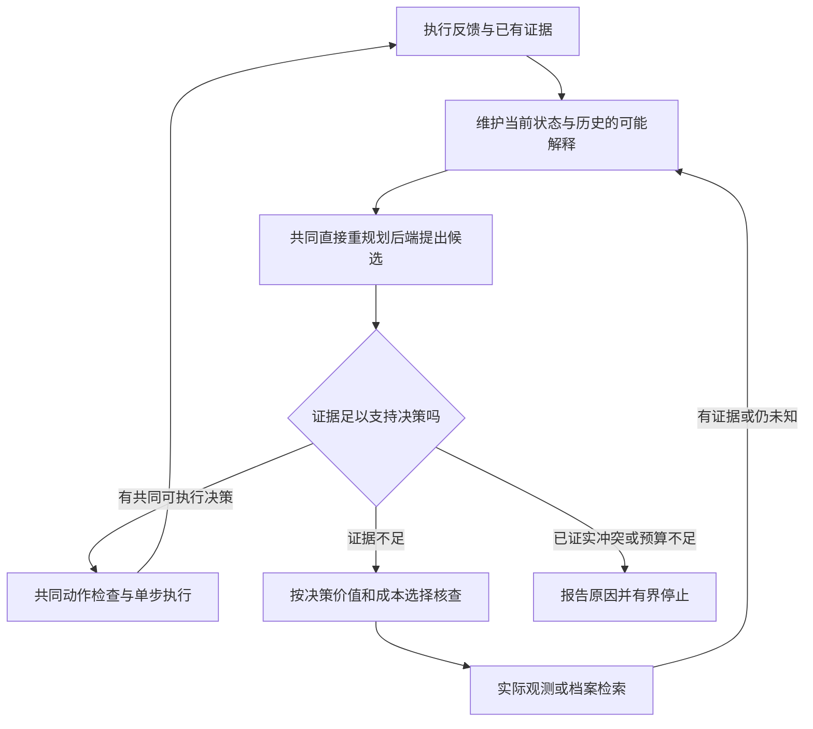

# 第三章新方向：问题定义、实现路线和首轮实验

日期：2026-11-13（北京时间）。用户已接受直接反馈重规划作为后端。本文为经过文献与代码核查后的实施设计，**不是新算法已完成或优势已建立的报告**。已有冻结数据保持不变。

## 1. 建议章节主线

暂定题目：**执行不确定性下的任务相关证据获取与大模型机器人规划方法**。

核心问题：执行结果不能由回执直接确认，且核查有代价时，如何选择足以支持当前任务决策的证据；什么时候继续执行，什么时候获取证据，什么时候承认证据缺口无法在预算内消除。

直接反馈重规划固定为共同任务规划后端。所有组共用同一模型、提示、技能、控制器和动作合法性检查。比较不同证据策略时，后端只接收该策略实际取得的观测与历史，不接收离线真值。算法选择导致后续信息不同是实验效应；初始信息、可访问证据池和预算必须相同。

这是目标架构。当前主链尚未支持完整 belief，也没有多类型查询执行器；旧 `State` 仍要求完整有限域状态。

## 2. “充分”与“必要”的定义先于算法命名

设 B 为与已取得证据一致的世界/历史解释集合，G 为已接受任务，A 为共同后端给出且经注册检查的候选决策。

- 对决策 a，R_a 表示它满足前置条件、历史义务及所声明后续可完成条件的解释集合。
- 若存在 a 使 B 包含于 R_a，则对该项决策已有充分证据；不要求将 B 缩小到唯一真实世界。
- 若多种动作均合法，区域可以重叠。不能按每个世界的 BFS 首条计划或 LLM 首选动作强行分类，否则不同的择优/并列处理就可能产生虚假的查询需求。
- “所有世界各自有后缀”不等于“有一条共同后缀”，也不等于“有一个可执行的条件策略”。先做整条候选后缀的充分性，再在明确查询能力和剩余预算后考虑下一动作的条件策略。
- 没有共同决策不等于任务无解；可能需要核查，也可能当前候选集合漏掉了合法动作。有限域精确搜索应审计候选覆盖，覆盖不足单列，不归咎证据策略。
- “必要”先限定为相对于已声明模型、证据渠道、预算和目标指标，避免全局最小证据的过度主张。小域用精确最优查询树给下界，较大问题只报告近似差距。

以上依赖模型与证据表示正确，不能写成开放物理世界的无条件安全保证。这一停止条件有 DRD 等先例，研究贡献应另行说明。

## 3. 证据层需要什么

建议另建 `ch3/evidence/`，保留旧 `ch3/revision/` 与冻结实验。第一版接口规划如下，尚未实现：

| 接口 | 输入/输出职责 | 禁止的简化 |
| --- | --- | --- |
| EvidenceRecord | 事实/事件、真/假/未知、来源、对象绑定、观测代次、时间范围、数据摘要 | 用模型自信或命令回执直接写 confirmed |
| EvidenceBelief | 当前状态和历史的相容解释，区分可行、冲突、未知及模型覆盖不足 | 未知位置默认 table、未知持物默认 empty |
| QuerySpec | 可核实内容、真实可用性、前置条件、费用、可能结果、物理状态影响 | 认为每个问题都能被完美回答 |
| QueryExecutor | 实际观察/检索，输出受约束的结果或 unknown，记录实际成本 | 从 evaluator truth 返回答案 |
| DecisionCertificate | 候选动作、依赖证据、适用任务/观测代次及有限域验证结果 | 仅以 yes/no 自信文本授权运动 |
| EvidencePolicy | 每次选择一个查询或返回已有充分决策、无法核实/预算停止 | 在算法里隐藏正确标签或免费重试 |

优先两类渠道：当前手/目标区域观测，和已经存在的事件档案检索。人工澄清先不作为必做模块，避免把修订用户要求误当成核实旧事件。

当前事实有时效：新动作或外部扰动后，旧持物/占用证据可能失效。历史已发生事件不因新照片而删除；后续取得的佐证应另存证据记录再重新解释历史，不覆盖原始账本。多次同图/同传感器的回答存在相关性，不将重复投票次数直接乘成高置信度。

## 4. 核查应作为有成本、可能改变状态的动作

首轮只注册实际能实现的核查方式：

1. 读取已归档的具体事件证据：文件缺失、遮挡或不足时返回 unknown。
2. 使用已有视角获取新图：只支持对当前事实判断，不能判定过去是否曾经放置。
3. 在已声明允许条件下执行固定小幅持物核查：同时记录手/物体变化和实际控制步。不能把它当无状态影响的信息接口。

不同核查方式可针对同一事实，但有不同成本和解析能力。必须先确认确有多种选择，不再沿用“等待固定次数后唯一动作可执行”的退化设置。不可读取 fixture 的故障类别、blackout 计数或将其转成传感器先验。

无响应、unknown、证据不可获得分别留日志；无信息时不能原地无限重复，也不能缩减 B。若核查改变了现场，按转移及新观测更新 B，不能只对旧世界集合做静态筛选。

## 5. 先建立标准参考，再设计候选改进

**第一层：静态精确参考。** 有限枚举当前/历史解释、可靠的受控查询、非均匀费用，计算最优自适应查询树；比较最小固定查询集、信息增益/费用和标准 DRD。只研究接口、定义和算法行为，不能称自然语言到机器人端到端实验。

**第二层：执行中的变化。** 加入 unknown 结果、证据过期、核查状态影响及预算；采用相应有限 belief-state 动态规划/条件规划作为强参考。此时不能直接继承静态 DRD 或独立测试的近似保证。

候选改进需回答：是否可以利用任务依赖和证据失效范围，避免每次在全部世界/全部查询上重新计算，并在相同正确性下减少在线计算或实际核查成本？如果仅是标准算法换问题名称，则明确归因标准方法，不宣称新搜索算法。

概率版本在有可靠先验和观测模型后才做。第一版可采用所有相容解释的鲁棒判定，并明确 worst-case 与 expected-cost 两种目标。合成均匀先验只能叫受控模型；不使用 LLM 口头 confidence 代替真实校准概率。

成本优先记录实际查询时间、控制步、模型请求/token 和执行动作；先画多目标权衡，不随意给“错误”“多看一眼”“多用 token”设权重凑优势。若用单一成本，提前公布单位、换算和失败/超时处理。

## 6. 基线按新问题设置

| 基线 | 对照意义 | 适用边界 |
| --- | --- | --- |
| 全量核查 | 检查是否减少无关信息获取 | 同一证据池、按同样费用收费；不能免费提供完整真值 |
| 固定顺序/缺失项规则 | 检查简单规则是否已够用 | 规则在开发后冻结，不能按测试标签排序 |
| 世界信息增益/费用 | 区分世界信息与任务决策价值 | 先验/查询模型与其他算法相同 |
| 最小固定事件集 | 与现有 `minimal_evidence_query` 比较 | 静态、单位成本版本保留；不可把它说成原本不考虑任务 |
| DiRECt/适用的 BiSECt | 必须保留的标准算法强对照 | 只在其假设成立的子问题比较，动态扩展需明确 |
| 同模型 LLM 选择查询 | 检查可计算选择是否优于模型判断 | 相同查询菜单、历史、反馈及总预算 |
| 小域精确策略 | 最优费用/停止条件参考 | 人工模型隔离实验；不等于大模型端到端结果 |

KnowNo/IntroPlan 用于相应歧义/帮助子任务的适配参考，不伪称直接复现物理证据获取；TAMPURA 用于动态不确定性机制比较的后续参考。无需首轮强行装齐全部大型系统。

## 7. 第一轮开发案例及可证伪主张

固定任务目标，控制器不变。优先做 12 个机制开发实例，覆盖下列六种机制各两种组合，不用颜色互换充当新族；不要按哪组模型会输挑案例。

| 机制 | 关键设置 | 希望检验的候选作用 |
| --- | --- | --- |
| 无关未知 | 存在多个未知，但不影响可执行决策 | 少查且不增加违规 |
| 同一事实的不同核查方式 | 便宜渠道可能 unknown，昂贵渠道更有效 | 依据结果选择或停止，而非固定拍照次数 |
| 自适应早停 | 第一次答案可能已足够，另一答案需继续 | 优于预先固定查询集合的成本；仍需对标准自适应算法比较 |
| 多个同时合法动作 | 不同解释的首选计划不同但可有共同动作 | 避免按任意首选分歧过问 |
| 档案缺失/不可核实 | 历史事实重要但证据不可取回 | 正确报告未知，不当作冲突或用当前图替代 |
| 核查改变状态/证据过期 | 核查后旧前置条件失效 | 更新现场并重新验证，不靠旧证据放行 |

这不是只制造“所有方法都缺信息”的任务。要同时有无需查询、便宜查询足够、昂贵查询必要、无法查询、即使查清也无解的控制条件。

候选主张分开：H1 保持共同正确性时减少核查成本；H2 减少不必要询问而不增加错误继续执行；H3 相对标准 DRD/条件规划减少在线计算或处理其静态实现不支持的动态证据。H3 必须给标准方法合理扩展，不能用不支持的输入直接判基线失败。

## 8. 指标与冻结条件

- 主指标：可完成任务在共同预算内的真实完成率，以及实际核查成本；符号完成与物理完成分开。
- 分项：错误 ready 提案、共同门槛阻止、实际违规下发、错误停止、无法核实、冲突、查询结果 unknown、执行器失败。
- 过问：相对于同一模型/预算下可证明无需查询的局面统计，同时给次数和分母。不可仅按后验已知真值将所有查询都说成多余。
- 过早执行：在核查前证据不能支持决策却提出或下发动作，提案与实际下发分开。
- 小域报告实际策略对最优费用的差距、停止判定一致性；概率/校准版本另画成功—帮助、风险—覆盖曲线，不把查询=成功假设偷渡进去。
- 失败、查询超时、截断和拒绝全部保留。成本不能只在成功样本统计；可补充共同成功配对的描述，但须另给全样本限时结果。
- 先开发、冻结协议及新组合实例，再正式测试。统计单位为任务实例，采样/布局重复不放大为独立任务类型。

最先要实现的是**证据渠道及相容解释接口**，然后标准精确参考与标准 DRD，最后才实现拟主张的改进。当前六个逻辑反例只确认定义的区别，尚没有新方法优势结果。

## 9. 当前资产怎么处理

保留：固定机器人技能、RGB 持物/释放核查、版本票据、历史事件、严格候选验证、真实调用与成本归档、已有持平和负结果。

从主贡献移出：增量 JSON 格式、局部修复必优于全量重规划、单纯引用原句检查、一般性的缺失项补问。

新增工作集中在证据策略与执行接口；本轮只完成查新、项目核查、定义及六个逻辑反例，不启动新大规模模型或物理试验。详细文献及原始链接见 [文献项目报告](chapter3_evidence_acquisition_literature_20261113.md)。
