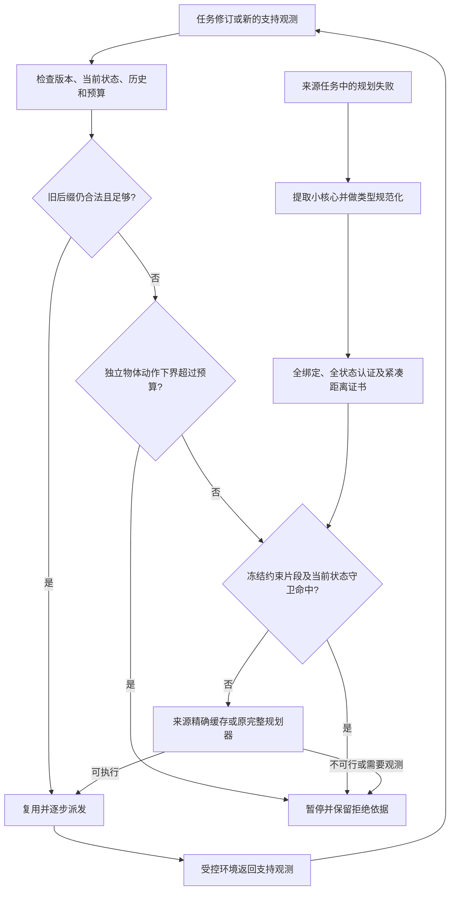

# 失败约束片段接入连续执行链：结果与边界

本轮已将冻结约束库接入原有的任务修订、支持观测与单步派发链。32 条连续序列共 384 次任务修订，学习组在保留相同合法后缀复用、独立物体动作下界和原始规划后端的条件下，少调用 24 次完整规划器；计入载入和重认证的在线费用中位数降低 6.4%。本轮没有提高任务完成率，也没有运行物理机器人或视觉模型。

## 接入方式

原运行时对外部提交的不可行判断会重新求解，以免接受未经验证的拒绝理由。把约束库作为外部候选提交会抵消收益。本轮新增隔离的内部规划入口，由重认证后的约束库同步产生结论，外部候选仍走原有验证。

[实现](../ch3/revision/fragment_runtime.py)复用原 `RevisionRuntime` 的六个方法原始代码：初始化、accept、observe、assess、issue、consume。三物体映射只用于符号接口；红物体编号不表示已有物理控制能力。

来源阶段与执行阶段分离，执行时不学习、不写缓存。命令和预测不会更新证据账本；只有显式支持观测追加事件。每次观测使旧派发票据失效。历史已完成的 visit 不再强行作为未来访问要求；未知历史仍由原后端保留 `need_observation` 及其诊断元数据。

## 事先固定的实验

[协议](fragment_execution_protocol_20261116.md)及[完整模板](../data/collections/fragment_execution_fixtures_20261116_v1/episodes.json)在求解前保存。固定种子 11681，32 条序列，每条 12 次修订，每次包含 3–6 条义务、明确涉及全部三物体；终态位置从合法状态采样。连续序列不重置状态或账本，新义务从当前 cursor 生效。

对照组包括旧核心、独立动作下界、相同来源精确缓存、后缀复用和原规划器；学习组仅增加先前从 384 个来源任务冻结的八个核心。两组均读取紧凑证书并完整重认证，不把额外离线算力排除在费用边界外。

任务模板预先指定无效果观测或外界合法状态变化。外界变化与规划器结果无关，可能使任务违例而暂停。这里的状态和事件来自有限状态模拟器，不能作为 RGB 感知或物理接触证据。

三轮交替方法顺序。执行循环计时包含决策、摘要、派发、观测和日志构造；准备计时包含域、下界、缓存及载入重认证。参考完整求解和独立审计在计时外执行，没有假延迟。

## 结果

以下均为同一批序列，确定性工作量每轮相同，时间为三轮中位数。

| 指标 | 固定强对照 | 加入失败约束片段 |
|---|---:|---:|
| 完整规划调用 | 288 | 264 |
| 约束片段提前识别 | 13 | 37 |
| 公共独立动作下界提前识别 | 134 | 134 |
| 合法后缀复用 | 1,183 | 1,183 |
| 来源精确缓存命中 | 0 | 0 |
| 内部决策时间 | 1,261.7 ms | 1,059.6 ms |
| 完整符号执行循环 | 2,136.8 ms | 1,933.8 ms |
| 载入与重认证等准备 | 57.7 ms | 120.0 ms |
| 准备加执行循环，逐轮合计的中位数 | 2,194.4 ms | 2,053.8 ms |
| 再加先前来源阶段费用的分阶段估计 | 3,161.8 ms | 3,073.1 ms |
| 完成的任务修订 | 197 / 384 | 197 / 384 |
| 初次即不可行的修订 | 166 | 166 |
| 初次可行、执行中暂停的修订 | 21 | 21 |
| 指令尝试 / 支持观测事件 | 1,234 / 1,179 | 1,234 / 1,179 |

因此，完整规划调用减少 **8.33%**，决策时间减少 **16.02%**，完整循环减少 **9.50%**，计入在线准备后减少 **6.41%**。中位数分别计算，表中分项中位数不应直接相加。

在线准备加循环的三轮配对节省为 **828.6、140.6、155.0 ms**。首轮固定组明显较慢，未分离冷启动与系统波动，不能以首轮大幅差距作为稳定增益宣传。三轮也不足以作统计显著性结论。

加入先前来源阶段费用后的中位数改善为 **2.81%**，但配对节省为 **788.1、−19.8、200.4 ms**：一轮较慢。该指标组合了先前来源实验和本次在线实验，是分阶段费用估计，不是重新测得的机器人端到端时间，不能据此宣称稳定的全生命周期优势。

受控环境实际产生 55 次无效果观测、52 次不同于请求动作的外界合法事件，以及 1,127 次正常动作事件。两组的状态、账本、全部决策状态、实际派发动作及完成结果完全一致。误拒和不合法 ready 后缀均为零。

## 优势具体来自哪里

[独立审计](../data/collections/fragment_execution_analysis_20261116_v1/metrics.json)重新运行 1,618 次完整决策，回放全部 1,179 个观测事件，并核查跨修订状态和账本连续性。24 次新增提前识别中：

- 12 次位于任务修订后的第一次决策；
- 12 次位于动作受外界事件干扰后的恢复决策；
- 移除四个新增三物体核心后，其中 18 次覆盖会消失。这是覆盖消融，未另做删核心后的运行时间实验。

这些差异既不是精确缓存命中，也不是关闭对照组后缀复用得到的结果。两组的后缀复用均达 1,183 次，说明普通有效后缀已经由公共机制处理，新增核心处理的是仍需考虑资源交互的少量困难拒绝判断。

按固定序列出现的首个恢复命中为 `execution-004` 第 2 次修订的第 1 次动作后：外界事件使蓝物体被拿在手中，黄、红在桌面；任务要求蓝最终位于绿区，蓝和红都访问绿区，黄还需在本次修订后访问桌面。

独立物体下界只得到 **5** 步，因此在 H=8 时不能拒绝。考虑单手与绿区独占，要先暂存蓝物体、让红访问并离开绿区、完成黄的访问，再把蓝放入绿区，最短需要 **9** 步。原规划器在 H=8 返回 conflict，H=12 返回长度 9 的 ready 计划；新核心能在 H=8 提前发现相同的预算冲突。

这个例子也限制了主张：拒绝的是当前模型和动作预算内的方案，不是物理上永远不可能完成的任务。延长预算可以恢复可行性，约束证书必须绑定预算。

## 可以写的结论与仍缺的证据

本轮支持的表述是：**在冻结有限模型中，从失败中提取并认证的关系约束片段，能够在保留正确后缀复用和原始规划后端的前提下，提前识别逐物体规则漏掉的交互型预算冲突，减少任务修订及受扰恢复时的完整求解。**

本轮没有证实更高任务成功率、物理机器人总耗时改善、开放世界泛化或独立于已知 nogood/约束迁移方法的论文新颖性。认证和存储成本仍高于固定规则组，且三物体域只有 34 个合法状态。复杂度扩大后的认证费用及真实控制耗时占比仍是边界。

下一项有价值的验证是沿用冻结核心和同样强对照，将实际控制器能可靠支持的少量任务接到支持观测接口，计入感知、动作和暂停时间。先确认完整观测覆盖、能力编译和可靠的三物体操作，不能把当前单物体物理桥接直接替换成三物体实验。若物理能力不足，应保留本轮为符号执行证据，不再靠扩大合成任务量加强结论。

新增运行时的 9 项针对性测试通过，全项目 **861 项测试通过**。测试覆盖证书免完整求解、历史和未知证据语义、当前状态变化、外部错误候选、过期版本和票据，以及预测不更新账本。

## 可复核文件

- [执行实验程序](../scripts/benchmark_fragment_execution.py)和[针对性测试](../tests/test_fragment_runtime.py)
- [三轮完整计时与调用来源](../data/collections/fragment_execution_validation_20261116_v1/timings.json)
- [汇总](../data/collections/fragment_execution_validation_20261116_v1/summary.json)和[学习组完整轨迹](../data/collections/fragment_execution_validation_20261116_v1/learned_trace.json)
- [独立分析程序](../scripts/analyze_fragment_execution.py)和[逐项新增覆盖](../data/collections/fragment_execution_analysis_20261116_v1/extra_coverage.json)
- [上一阶段认证优化结果，包括负结果](fragment_certification_optimization_results_20261116.md)
