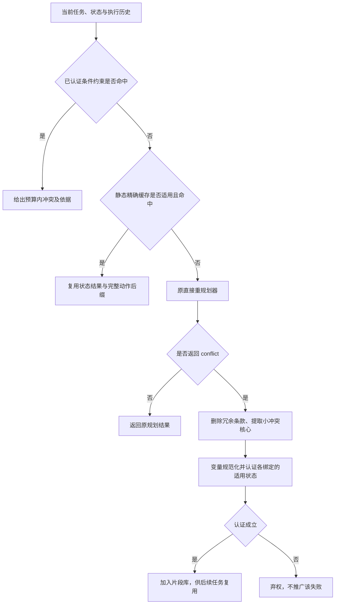

# 从失败提取可验证、可迁移约束片段：补强基线后的结果

日期：2026-11-16。

本轮将问题收紧为：**原规划器报告任务失败后，能否自动获得带适用条件的约束片段，使后续不同任务避免重复不可行求解？** 直接重规划器继续作为后端；任务目标、动作语义、H=8 预算和双物体领域不变。没有增加语言模型、机器人技能、训练或迁移仿真平台。

结论：把此前发现的预算规则完整交给对照后，固定来源流仍自动获得两类三条款核心。冻结后，相对“完整旧规则库＋来源精确缓存”，在既有 56,774 个组合中额外避免 **336 次完整任务后端求解（3.39%）**。统一在线接口下，查询时间中位数下降 **6.82%**；计入来源构建、学习、缓存加载和证书重认证后的总算法时间估计下降 **2.69%**。但配对完整成本只有 **2/3 轮**占优，有限域计算优势较小且有波动。

这些目标组合此前已查看。本轮是冻结流程下的回顾性强对照和机制审查，不能写成全新盲测、独立机器人任务或已成立的投稿新颖性。全部新完整任务拦截已由原求解器重新核验；每组每轮 **9,910 个 ready 后缀**均执行合法性重放；全量回归 **824 passed in 6.72s**。

## 优化后的方法主线

只在真实后端 conflict 后学习；坏候选动作不等于任务无解。静态缓存保存完整动作计划，不只保存 ready 标签。存在历史或 before 顺序约束时不使用静态缓存键。片段认证仍使用必要未来任务的松弛；不能用历史松弛的可行结果代替完整历史决策。

冻结同时关闭学习与缓存写入，避免后续计时复用测试答案。编译器、特征、运行语义检查与后端对所有组一致。当前在线接口是原符号恢复决策模块的包装，尚未接入物理机器人执行主链。

## 第一关：完整补齐旧知识

对照一开始取得六类专家核心、三个既有种子核心和此前新增的二条款预算核心。它与旧学习库的编译条件逐项相同。此前 308 个额外覆盖因此不再构成相对这一补强对照的优势。

首次预运行只比较旧表时发现：经共同特征推导后语义冗余的 at/visit 条件可以具有不同表项。该次在来源循环之前停止，保留不完整 v1；之后将全部旧种子也提供给对照，在来源 v2 正式运行。没有读取新目标表现后选择补哪些规则。

固定学习来源为旧 7,532 个输入，随机种子 11661，不按结果抽样。来源阶段不读取迁移目标及其结果。这里的“失败”是符号后端报告预算内不可行，不是新增机器人执行失败。

## 第二关：两类自动新增核心

两类均由固定来源顺序上的真实 conflict 自动触发删除最小化、变量规范化和有限状态认证，没有手工交给学习组。

| 核心 | 任务条款 | 来源实例的最短可行预算 |
| --- | --- | --- |
| A | at(x,r)、visit(x,s)、visit(y,s)，x≠y、r≠s | 9 步 |
| B | at(x,r)、visit(x,s)、visit(y,r)，x≠y、r≠s | 10 步 |

来源 A：yellow 最终回桌面，blue 和 yellow 都需在当前时刻之后经过 green；当前 blue 在 green，手持 yellow。来源 B：blue 最终回 green，blue 需经过 return，yellow 需经过 green；当前 blue 在 green、yellow 在 return。

来源中的每一个核心均满足：8 步不可行；删除任意一个核心条款后都有不超过 8 步的合法后缀。A 的三个删除见证长度为 7、7、3；B 为 6、8、6。原求解器在预算提高至 9/10 后分别找到合法完成后缀。因此，这些是**预算相关冲突**，不能写成永久不可完成。9/10 是来源实例的最短长度，不是所有变量绑定和状态统一的长度。

两类核心不是两个已独立验证的新机器人故障机制，而是同一预算/资源相互作用下的两种任务结构。人类仍可以补入同样的规则；本轮验证的是自动获取与复用，不是证明人工规则原则上无法表达。

## 第三关：超出精确缓存的冻结复用

固定来源中所有已观察静态结果的缓存并集提供给双方，共 **3,787 个键**，包括原后端动作后缀。保守剔除旧来源签名后保留原来的 56,774 个目标组合。来源与目标已有审计资料保持不变，不按本轮命中情况挑选子集。

| 目标阶段 | 补强规则＋精确缓存 | 同一规则/缓存＋新片段 |
| --- | ---: | ---: |
| 认证规则/片段直接拦截 | 44,878 | 45,226 |
| 规则未命中后由缓存处理 | 1,983 | 1,971 |
| 完整任务实际后端调用 | 9,913 | 9,577 |
| 结果与原求解器一致 | 56,774/56,774 | 56,774/56,774 |

片段新增 348 个规则命中，其中 12 个原本可由缓存处理，所以只将 **336** 计入新增节省。原求解器对这 336 个请求逐个再次确认 conflict；48 个历史边界探针未发生错误拒绝。

另做了事后解释性消融，未冒充预先注册的主指标：

- 仅保留原始物体名、目标名和来源精确状态，但允许核心作为子集复用，额外覆盖 **53** 个请求。
- 完整类型泛化与适用状态认证额外覆盖 **336** 个请求。
- 忽略适用状态、对两个新核心的类型绑定直接推广，会将 **4,966 个可行请求**误判为冲突。

这支持适用条件的必要性及片段泛化的作用。53→336 同时包含变量绑定和状态范围的变化，不能把全部增益单独归因其中一个组件；消融仍限于同一有限模型。

## 准备费用与真实调用总账

第一版审查程序共享固定对照的后端结果、额外计算两次匹配并逐条生成审计摘要。计入这整个流程时：查询中位数 16.757→15.790 s，但含全部审查准备的总估计 **19.577→20.112 s，反而慢约 2.73%**。该负结果保留。

为测量实际在线方法费用，新增共同的 `FragmentSession`。双方都从来源第一条请求开始使用精确缓存；只允许学习组在 conflict 后提取。摘要、额外见证核查和 JSON 归档移至计时外，双方一致。三个来源重复、三个目标重复串行完成，顺序交替，完整保留波动。

| 统一在线接口，单次来源学习＋单批目标 | 补强规则＋缓存 | 加自动片段学习 |
| --- | ---: | ---: |
| 来源实际完整任务调用 | 3,819 | 3,805 |
| 来源学习核心 oracle 调用 | 0 | 320 |
| 来源构建/处理中位数，含加载合并 | 1.999 s | 2.267 s |
| 完整准备费用，含重载认证 | 2.318 s | 2.954 s |
| 目标查询三轮中位数 | 16.882 s | 15.730 s |
| 上两项之和 | **19.200 s** | **18.684 s** |

完整准备费每个假设批次都计入一次，没有用三轮重复摊薄。表中总数是来源准备中位数、一次实测重载费用和目标查询中位数之和，属于**总算法时间估计**，不是物理执行或语言模型系统端到端时间。共同目标输入生成/加载、计时外审计与归档不计入；源输入加载与公共缓存解析计入。

各轮目标查询：

| 轮次 | 固定 /s | 学习 /s |
| --- | ---: | ---: |
| 1 | 17.063 | 15.730 |
| 2 | 16.882 | 15.708 |
| 3 | 16.451 | 15.891 |

将对应轮次来源准备与目标查询相加，并各计入一次重载，完整成本节省为 **1.370 s、0.612 s、−0.761 s**。最后一轮学习来源处理较慢，没有删除。三轮计算重复不足以主张稳定或显著的系统加速。

尤其不能把“少 336 次目标后端调用”写成“所有求解器调用都更少”：

| 一次来源＋一次目标＋一次重载 | 固定 | 学习 |
| --- | ---: | ---: |
| 来源完整任务求解 | 3,819 | 3,805 |
| 初始共同规则认证 | 650 | 650 |
| 学习核心提取/认证 | 0 | 320 |
| 目标完整任务求解 | 9,913 | 9,577 |
| 重载证书核验 | 650 | 962 |
| 全部 oracle/后端调用 | **15,032** | **15,314** |

学习组总求解次数反而多 **282**，其子核心认证比部分完整任务搜索便宜，因而仍可能取得较低总时间。不能隐藏这部分工作。按目标组合平均，完整成本中位估计仅节省约 **9.1 微秒/输入**，实际机器人延迟意义仍未证明。

## 本轮能支持的章节表述

建议保持章节主线：**面向执行失败的条件约束提取与验证复用**。新增证据说明当前机制并非只能恢复原先那一条预算规则；在更强固定知识和精确缓存之外，仍能自动获取另外的约束并复用。

当前可以写：在已注册有限模型和动作预算内，从后端失败自动提取删除最小的任务核心，认证类型绑定和适用状态，并在任务组合变化时复用，以减少部分重复完整任务求解。

当前不能写：发现了全新冲突学习原理、适用于任意开放世界、机器人任务成功率提升、普遍优于人工规则、所有求解调用减少、或已足够作为独立投稿创新。现有“失败→约束→复用”的相关方法差异仍须论证。

后续验证应保持本轮方法冻结，集中检验**独立任务结构中的约束获取、认证规模成本，以及现有执行链里的真实恢复收益**。不再通过同模型多枚举组合或反复选计时来充当创新证据。

## 产物

- [强对照冻结方案](/root/autodl-tmp/ch3-planning/docs/fragment_strong_control_protocol_20261116.md)
- [统一在线成本方案](/root/autodl-tmp/ch3-planning/docs/fragment_online_protocol_20261116.md)
- [在线失败约束会话](/root/autodl-tmp/ch3-planning/ch3/revision/fragment_session.py)
- [在线接口检查](/root/autodl-tmp/ch3-planning/tests/test_fragment_session.py)
- [固定来源学习及见证](/root/autodl-tmp/ch3-planning/data/collections/fragment_strong_control_source_20261116_v2/summary.json)
- [强对照迁移审查](/root/autodl-tmp/ch3-planning/data/collections/fragment_strong_control_transfer_20261116_v1/summary.json)
- [在线来源真实成本](/root/autodl-tmp/ch3-planning/data/collections/fragment_online_source_20261116_v1/summary.json)
- [在线目标复验](/root/autodl-tmp/ch3-planning/data/collections/fragment_online_transfer_20261116_v1/summary.json)
- [独立调用总账及配对结果](/root/autodl-tmp/ch3-planning/data/collections/fragment_online_analysis_20261116_v1/metrics.json)
- [适用条件消融](/root/autodl-tmp/ch3-planning/data/collections/fragment_online_analysis_20261116_v1/guard_ablation.json)
- [核心与高预算完成后缀重放](/root/autodl-tmp/ch3-planning/data/collections/fragment_online_analysis_20261116_v1/core_replay.json)
