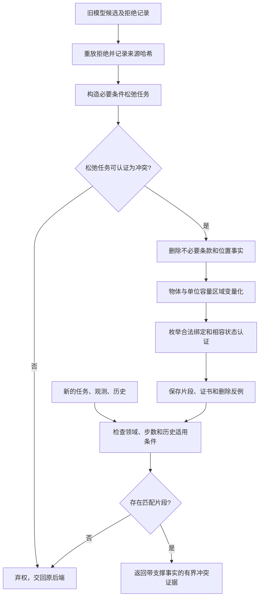

# 从失败到可验证、可迁移的约束片段：原型与离线结果

日期：2026-11-16。**已实现自动极小冲突核心提取、类型化变量替换、有限域证书核验和片段复用。** 从既有真实模型失败中自动得到 4 类片段，在 7,532 个有限输入上未出现误拒。相对带原名称的核心，变量化新增覆盖 498 个输入；但人工不变量覆盖更广，当前原型的局部总耗时也更高。因此，本轮证明机制可运行及同域复用有效，尚未证明规划性能优势或独立投稿创新。

## 实际流程

新增代码均为确定性提取、认证和匹配，本轮模型请求为 **0**，没有权重训练。候选被拒只触发提取，不直接构成任务不可行的证据。若一条失败动作存在合法替代后缀，程序不能把它提升为整个任务的冲突规则。

提取时保留终态条件和未来保护条件；只将所有历史分支都尚未完成的 visit 作为未来必经，放松历史顺序和历史禁令违例。此任务弱于每个实际历史分支。若弱任务在所有符合保留位置事实的状态中都没有有界解，才产生片段。匹配后返回 conflict 的含义仍是当前注册有限模型和动作上限内不可行，不扩展为物理世界中绝无办法。

## 四类片段从哪里来

来源为上轮冻结验证的 **55 个实际拒绝候选、9 个不同案例**；它们现在作为开发来源，不再称本轮新验证。拒绝全部重新运行原检查器核实，提取器不读取预期标签或任务族。只有 3 个来源案例能在静态松弛下认证出冲突，去重后得到 4 类片段。

下面使用不同字母表示不同对象；r、s 为容量 1 的区域。visit_pending 要求所有可能历史中都没有已满足该必经的证据，且严格遵循生效锚点。

| 自动片段 | 约束条件 | 来源 | 本批首次命中数 |
| --- | --- | --- | ---: |
| 受保护对象无法交付至被占用目标 | goal_at(x,r) ∧ protect(x) ∧ at(y,r)，x≠y | validation-05，正向删除 | 168 |
| 受保护对象无法改变区域 | goal_at(x,r) ∧ protect(x) ∧ at(x,s)，r≠s | validation-05，反向删除 | 112 |
| 受保护阻挡物使未来必经不可达 | visit_pending(x,r) ∧ protect(y) ∧ at(y,r)，x≠y | validation-15 | 172 |
| 终态容量冲突 | goal_at(x,r) ∧ goal_at(y,r)，x≠y | validation-19 | 343 |

首次命中按归档模式顺序计数，同一输入若符合多个模式，只归给第一个。各条件对应程序实际提取的原子，规则内容没有通过模型生成或人工逐条写入片段库。人工规定的是原子语言、松弛方式、删除顺序和核验算法。

第二类当前只覆盖两个不同的单位容量区域，尚未自动概括到“只要不在目标位置就冲突”；原位置为 table/hand 的其他情况不会凭经验擅自扩大匹配。它展示了自动提取仍存在过窄的状态条件。

其余 6 个来源案例弃权，包括有合法腾位方案的任务、历史证据不确定、单独重启一个时间范围造成的顺序冲突。当前模块尚无历史顺序片段，不会把这些未覆盖机制写成已解决。

## 什么使片段可验证

1. 每个核心使用两种预先指定的贪心顺序删除原子，得到包含意义上的极小核心；不声称找到了最小基数或全部核心。
2. 物体与容量 1 的区域采用类型变量，变量绑定保持不同实体互不合并。table 和 hand 保留独立语义，不能把无限容量桌面当成单位容量区域。
3. 逐个枚举所有变量绑定和相容合法状态，核查 8 步内不可行；删除任一个原子必须能提供一个可完成反例，保存其状态与后缀。
4. 模式载入时重新认证，不信任文件中的 verified 字样。改变领域/推理代码或提高动作上限时，旧证书失效或弃权。
5. 在线返回具体变量绑定及支撑原子；未匹配返回 None，交回同一后端，不生成替代动作，不擅自修改任务或确认未知历史。

独立结果复核重新提取了全部模式、认证了全部绑定，逐步检查了 **22 条删除反例后缀**，并重放 7,532 个输入上各组的命中和三态结论。它使用相同有限领域语义，属于归档与实现复核，不是独立物理证据。

## 新组合与对照结果

生成 15 个原子条款池中 0 至 3 条的全部组合，交叉 13 个合法状态，共 7,488 个潜在输入；剔除 4 个与开发来源具有相同松弛任务和状态签名的输入，剩余 **7,484 个组合**。另有 **48 个历史边界探针**，交叉改变对象角色、区域、证据状态、起算点和保护状态。

全部 7,532 个输入的基准结果为 ready 4,371、conflict 3,157、need_observation 4。这是有限状态空间覆盖检查，多个输入高度相关，**不能写作 7,532 次机器人实验，也不能据此计算独立样本显著性**。

| 方法 | 片段/规则直接命中 | 回退求解次数 | 误报冲突 | 三态结论与基准一致 | 局部总计时 |
| --- | ---: | ---: | ---: | ---: | ---: |
| 每次重新求解 | 0 | 7,532 | 0 | 7,532/7,532 | 3.530 s |
| 保留原物体/区域名称的极小核心 | 297 | 7,235 | 0 | 7,532/7,532 | 4.273 s |
| 类型变量化片段 | 795 | 6,737 | 0 | 7,532/7,532 | 4.611 s |
| 人工领域不变量 | **3,003** | **4,529** | 0 | 7,532/7,532 | **2.016 s** |

各组均实际运行未命中后的相同求解器，并非只用命中率推算节省。局部总计时包含该组匹配及回退处理，不包含提取认证，不代表机器人系统端到端延迟；单次计时也不足以作稳健速度结论。

变量化相对带常量核心增加 **498** 次直接命中，原有 297 次命中全部保留，合计约为原来的 **2.68 倍**；覆盖当前冲突输入的 **25.18%**，相对逐次求解减少 **10.55%** 的求解调用。这是同一模型下物体/区域角色更名及任务组合复用的收益。

人工不变量覆盖了全部 795 个片段命中，并额外覆盖 **2,208** 个。片段没有任何人工基线无法判定的独有冲突。人工基线利用完整已知领域性质，不受从少数失败提取模式的覆盖限制；这个结果不应被隐去。

当前变量化总计时比逐次求解更长，原因包括变量匹配、适用性与源码指纹核验开销，而领域本身仅有 13 个状态，原求解已很便宜。不能用少调用 795 次求解替代实际耗时，宣称系统已经加速。

## 历史边界检查

48 个探针中，带原名称核心命中 4 个，变量化命中 16 个，人工不变量也命中 16 个；均无误拒。对已完成必经、可能已经完成的未知记录、解除保护等情况，程序保守弃权，由同一后端处理。对 refuted 记录及事件恰好落在生效起点的情况，程序不会误认必经已完成。

这证明当前静态片段在这些明确列出的边界上没有越权。它没有实现不确定历史的完整片段学习，也没有从末态推断过去发生了什么。

## 开销和完整性

- 训练来源拒绝重放：55 个候选，9 个案例；提取不调用语言模型。
- 自动提取：128 次有界求解；带常量核心认证：47 次；变量化认证：107 次；实验同时构建两组共 **282 次**。仅构建变量化路径为 128+107 次。
- 两组提取及认证阶段本次墙钟约 **0.296 s**，包括来源检查；这不包含人工建模和已有实验数据生成成本。
- 原始来源、冻结新输入、模式、证书及源码运行结束时哈希全部未变。没有改写旧负结果。
- 全量回归 **788 passed in 5.96s**，包含新增 55 项检查；格式检查通过。另有结果复核脚本核对原始归档。
- 没有新增模型请求、物理仿真运行或真实机器人实验；模块尚未接入真实执行主链或重新运行模型五组比较。

## 对方法贡献的判断与下一步

这轮可以写清楚一个可实现的方法模块：**失败触发必要条件松弛，提取极小冲突核心，将状态适用条件与任务约束一同变量化，再经有限域认证后复用。** 相对上一轮纯文字经验提示，当前输出有明确的逻辑含义、适用条件与可重放证据；实际收益是同域核心覆盖扩大。

但领域前置条件本来就已知，核心认证还依赖同一领域求解器。当前学到的是旧模型中逻辑冲突的可复用摘要，没有发现未知物理规律，也没有超出人工规则的决策能力。

相关方向已有 [COAST](https://arxiv.org/abs/2405.08572) 的失败转规划约束、[score-space 约束迁移](https://arxiv.org/abs/1807.09962) 和 [VIZ-COAST](https://commalab.org/papers/vizcoast/) 的跨实例约束生成。因此“失败→规则→复用”不能单独作为新意；有限域穷举证书和核心缓存也不能仅靠重新命名认定创新。

建议下一步只做小范围的**适用条件自动放宽与反例修正**：例如把“受保护对象恰好在另一个区域”放宽成“受保护对象不在目标”，让程序从反例决定可放宽到哪里。首先比较源事实精确匹配、纯类型更名、条件放宽和强人工规则，检查误拒、覆盖与总成本；暂不扩模型调用或物理实验。放宽后的任何模式仍须核验，未知物理执行失败只能作为假设来源，不应直接升级为永久硬约束。这个改进尚未实现，仍需与现有约束获取/核心泛化算法明确区分。

## 产物

- [片段提取、认证与匹配代码](/root/autodl-tmp/ch3-planning/ch3/revision/fragments.py)
- [新增检查](/root/autodl-tmp/ch3-planning/tests/test_revision_fragments.py)
- [实验前冻结协议](/root/autodl-tmp/ch3-planning/docs/revision_fragments_protocol_20261116.md)
- [运行脚本](/root/autodl-tmp/ch3-planning/scripts/benchmark_revision_fragments.py)
- [自动片段](/root/autodl-tmp/ch3-planning/data/collections/revision_fragments_20261116_v1/patterns.json)
- [证书及删除反例](/root/autodl-tmp/ch3-planning/data/collections/revision_fragments_20261116_v1/certificates.json)
- [来源与提取记录](/root/autodl-tmp/ch3-planning/data/collections/revision_fragments_20261116_v1/mining.json)
- [原始检查结果](/root/autodl-tmp/ch3-planning/data/collections/revision_fragments_20261116_v1/results.json)
- [对照汇总](/root/autodl-tmp/ch3-planning/data/collections/revision_fragments_20261116_v1/summary.json)
- [离线重放分析](/root/autodl-tmp/ch3-planning/data/collections/revision_fragments_analysis_20261116_v2/analysis.json)
